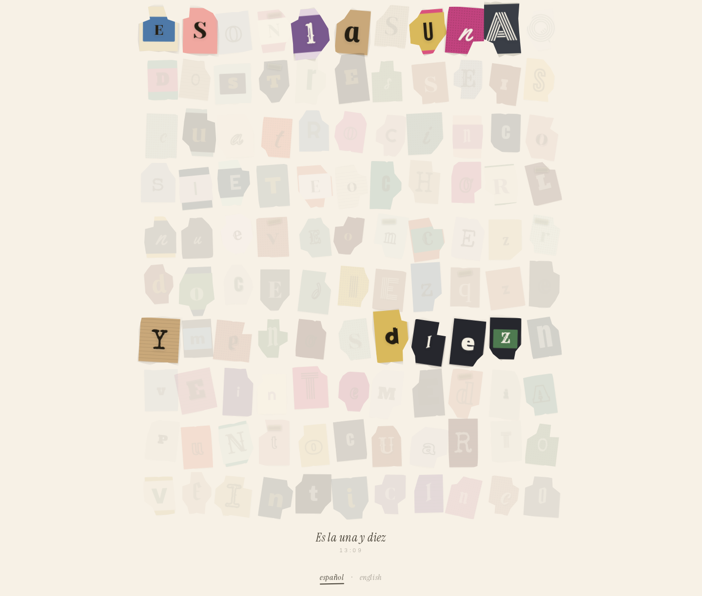

# Reloj

The time in words — a word clock that reads like a ransom note. EN / ES.

Live: https://colmeio.github.io/reloj



## What it is

A 10×11 grid of magazine scraps — every letter cut from a different page: its own typeface, paper color, scissor-cut polygon, and print treatment (outline, offset shadow, color chip, tape, halftone). The current time lights up as a phrase — *Son las dos y media*, *It is half past two* — rounded to five minutes, the way word clocks speak.

A serif-italic caption below the grid reads the phrase aloud to screen readers (`aria-live`), with the exact time as a numeric whisper underneath. Language is an open list — español · english — that grows when new packs arrive.

On load, the scraps fall into place as a diagonal cascade. On the minute, the phrase's letters wake with a stagger while the rest of the board stays quiet.

## How a scrap is made

Each of the 110 cells runs a small deterministic generator (`src/scrap.ts`): the cell index seeds a mulberry32 stream that rolls a typeface (17 candidates), a paper from a 26-color vintage palette, an ink picked by WCAG contrast tiers, a 14-point jittered polygon with corner-cuts and lean, rotation, size chaos (25–70px), and a print treatment. Same cell, same scrap, every load — nothing stored, nothing random at runtime.

Unlit letters rest as desaturated ghosts; lit ones snap to full ink with a paper-lift shadow.

## Engineering notes

- Runtime dependencies: React, ReactDOM and a self-hosted Inter. No UI kits, no color libraries — the WCAG ink picker is ~15 lines of code
- ~73 KB gzipped JS; display fonts glyph-subsetted from Google Fonts (~6.6 KB each, only the grid's letters)
- Reading-order tests: every minute of the day, in every language, must read top-to-bottom / left-to-right on the grid
- Time logic is pure and snapshot-tested across all 1,440 minutes per language
- `prefers-reduced-motion` respected; the decorative grid is `aria-hidden`

## Languages

Each language is a pack: its own letter grid plus its time grammar (`src/languages`). Adding a language = adding one pack — the tests, the language list and the numeric time pick it up automatically.

## Development

```sh
pnpm install
pnpm test
pnpm dev
```

## License

Apache-2.0 · [colmeio](https://github.com/colmeio)
